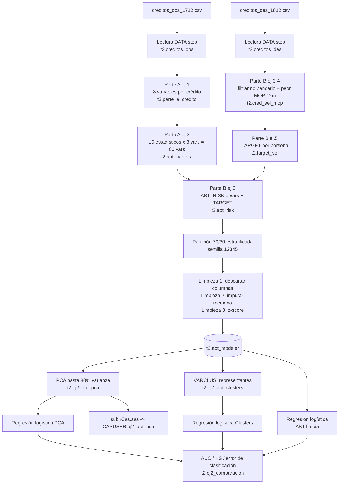

# Proyecto de Analítica de Datos — Modelo de riesgo de crédito en SAS

Pipeline en **SAS Studio / SAS Viya** que construye una *Analytical Base Table* (ABT) a nivel persona a partir de
historiales de crédito, define una variable objetivo de incumplimiento (`TARGET`), limpia y estandariza los
predictores, y compara tres formas de usar las variables (todas, PCA y clusterización de variables) con una
regresión logística.

## ¿Qué hace el programa, en una frase?

Con el historial crediticio de **2017** (ventana de observación) construye variables explicativas por persona, y con el
comportamiento de pago de **2018** en créditos del otorgante **no bancario** (ventana de desempeño) define quién
cayó en mora grave (`TARGET = 1`); después prepara los datos para modelar y compara métodos de reducción de dimensión.

## Estructura del repositorio

```
.
├── README.md
├── .gitignore
├── data/                       # CSV de entrada (no versionados)
│   └── README.md
├── docs/
│   ├── 01_preparacion_abt.md   # Documentación bloque por bloque / macro por macro
│   ├── 02_reduccion_abt.md     # PCA vs VARCLUS vs ABT limpia
│   ├── 03_subir_cas.md         # Carga de la tabla a CAS
│   ├── diccionario_datos.md    # Columnas de entrada y de las tablas generadas
│   └── notas_y_observaciones.md# Supuestos, puntos a verificar, mejoras
└── src/
    ├── 01_preparacion_abt.sas
    ├── 02_reduccion_abt.sas
    └── 03_subir_cas.sas
```

## Flujo general



## Cómo ejecutarlo

1. Copia `creditos_obs_1712.csv` y `creditos_des_1812.csv` a una carpeta accesible desde SAS (Studio/Viya).
2. En `src/01_preparacion_abt.sas` ajusta `%let ruta = ...;` (ahí también se define el otorgante, la fecha de corte y la semilla).
3. En `src/02_reduccion_abt.sas` y `src/03_subir_cas.sas` ajusta la ruta de la librería `t2` / `prep` (debe apuntar a `<ruta>/preparacion_proyecto`).
4. Ejecuta en orden: `01` → `02` → `03`.

| Script | Entrada | Salidas principales |
|---|---|---|
| `01_preparacion_abt.sas` | 2 CSV | `t2.abt_parte_a`, `t2.target_sel`, `t2.abt_risk`, `t2.abt_modeler` (+ CSV de diagnóstico) |
| `02_reduccion_abt.sas` | `t2.abt_modeler` | `t2.ej2_abt_pca`, `t2.ej2_abt_clusters`, `t2.ej2_comparacion`, `t2.ej2_representantes` |
| `03_subir_cas.sas` | `t2.ej2_abt_pca` | Tabla `ej2_abt_pca` promovida en `CASUSER` |

## Parámetros configurables (macrovariables)

| Macrovariable | Valor | Para qué sirve |
|---|---|---|
| `&ruta` | carpeta del proyecto | Ubicación de los CSV |
| `&ruta_resultados` | `&ruta/preparacion_proyecto` | Carpeta de la librería `t2` y de los CSV exportados |
| `&otorgante` | `nobancario` | Otorgante cuyos créditos de 2018 definen el TARGET |
| `&corte_obs` | `30DEC2017` | Fecha de corte para calcular antigüedad |
| `&semilla` | `12345` | Semilla de la partición entrenamiento/validación |
| `&meta_pca` | `0.80` | Varianza acumulada objetivo para elegir componentes |

## Documentación

- [`docs/01_preparacion_abt.md`](docs/01_preparacion_abt.md)
- [`docs/02_reduccion_abt.md`](docs/02_reduccion_abt.md)
- [`docs/03_subir_cas.md`](docs/03_subir_cas.md)
- [`docs/diccionario_datos.md`](docs/diccionario_datos.md)
- [`docs/notas_y_observaciones.md`](docs/notas_y_observaciones.md)
